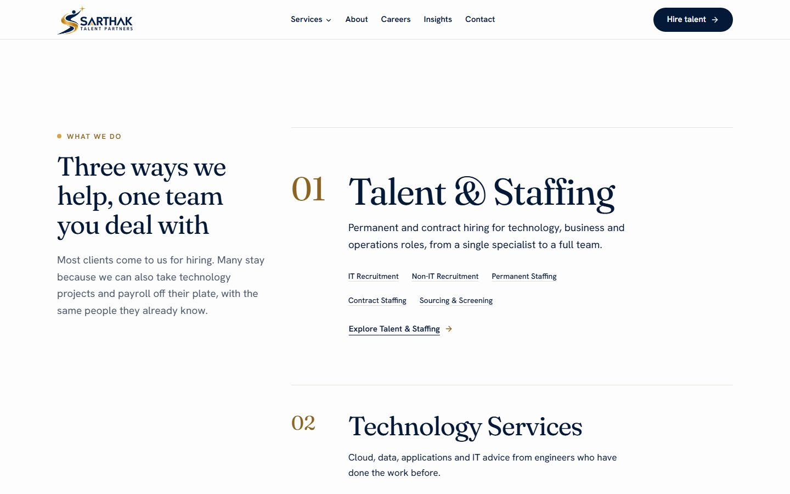
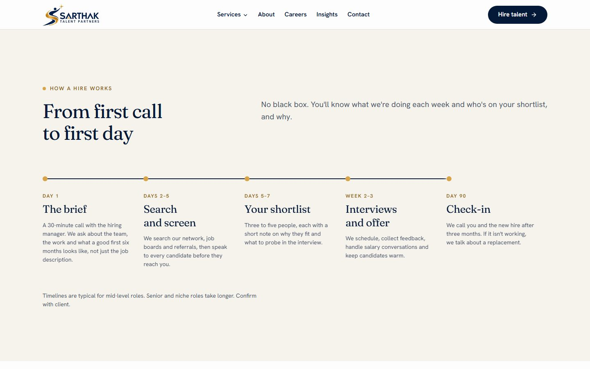
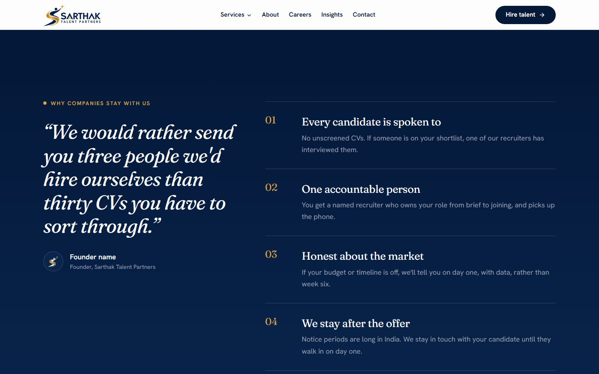
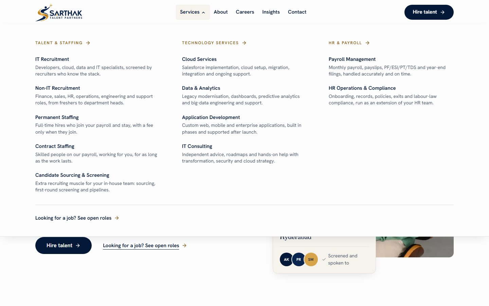
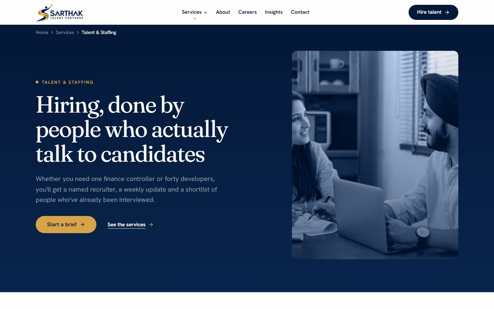
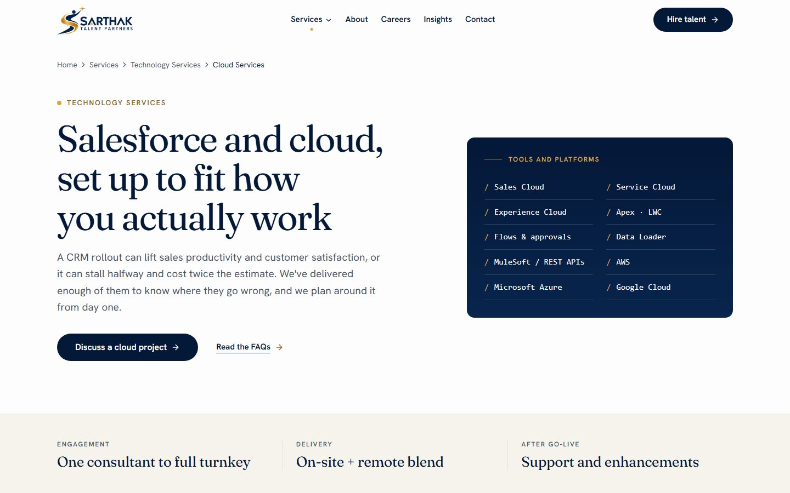
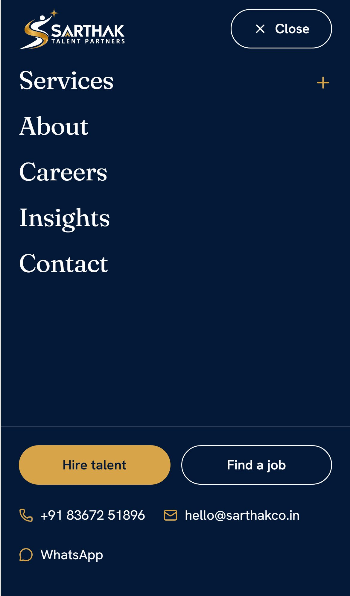
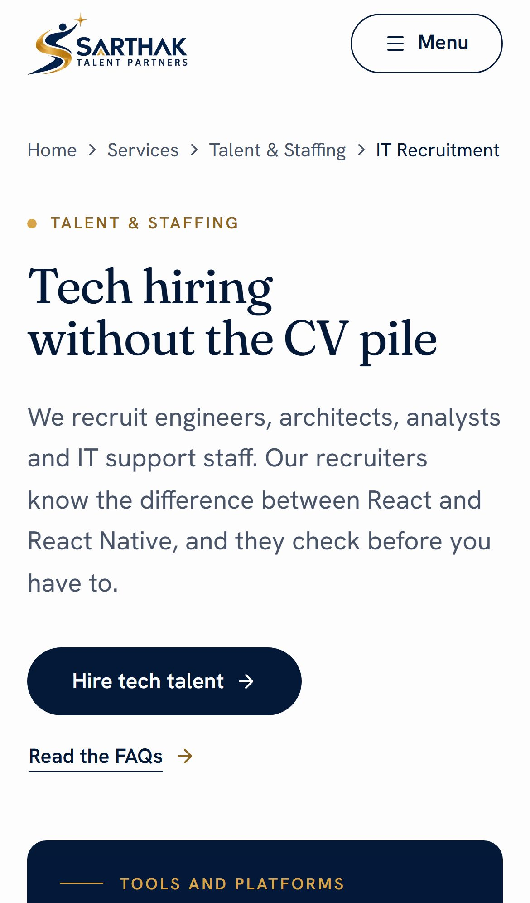
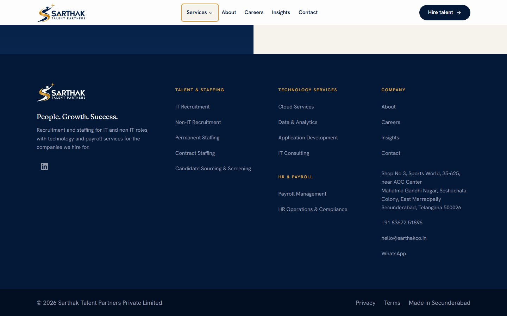

<p align="center"></p>

# Sarthak Talent Partners website

Marketing website for **Sarthak Talent Partners** (Sarthak Talent Partners Private Limited), an Indian recruitment, staffing, technology services and HR/payroll company based in Secunderabad, Telangana.
Tagline: *People. Growth. Success.*

- Live site: [www.sarthakco.in](https://www.sarthakco.in)
- Enquiries: hello@sarthakco.in · Job applications: careers@sarthakco.in

Built with Next.js 16 (App Router), React 19, Tailwind CSS v4 and shadcn/ui. Every page is statically generated, and all copy lives in Markdown files under `content/`.


## Screenshots

| Desktop | |
|---|---|
|  |  |
|  |  |

| Services: Talent & Staffing | Service page: Cloud Services |
|---|---|
|  |  |

| Mobile home | Mobile menu | Mobile service page | Footer |
|---|---|---|---|
|  |  |  |  |

## Tech stack

| Area | Choice |
|---|---|
| Framework | Next.js 16 App Router, React 19, TypeScript (strict), Turbopack |
| Styling | Tailwind CSS v4 (CSS-first `@theme` tokens in `src/app/globals.css`) |
| Components | shadcn/ui on Radix, restyled to the Sarthak brand |
| Motion | `motion` (LazyMotion), always honouring `prefers-reduced-motion` |
| Content | Markdown/MDX with YAML frontmatter, validated by `zod` at build time |
| Fonts | Fraunces (display) and Hanken Grotesk (body) via `next/font` |
| Forms | Web3Forms (free tier), posted from the browser |
| Hosting | Vercel, with Vercel Analytics and Speed Insights |

## Getting started

Requirements: Node.js 20.9 or newer, and pnpm.

```bash
pnpm install
cp .env.example .env.local   # fill in the values when you have them
pnpm dev                     # http://localhost:3000
```

To test on a phone, connect it to the same Wi-Fi and open the **Network** URL that `pnpm dev` prints (for example `http://192.168.1.53:3000`). Local network addresses are allowed in `next.config.ts`.

## Scripts

| Command | What it does |
|---|---|
| `pnpm dev` | Local dev server with hot reload |
| `pnpm build` | Production build. Fails on type errors, lint errors or invalid content |
| `pnpm start` | Serve the production build |
| `pnpm lint` | ESLint |
| `pnpm typecheck` | `tsc --noEmit` |
| `pnpm placeholders` | Lists every `[[placeholder]]` still waiting for client details and rewrites `PLACEHOLDERS.md` |
| `pnpm format` | Prettier with the Tailwind class sorter |

## Environment variables

| Variable | Purpose |
|---|---|
| `NEXT_PUBLIC_SITE_URL` | Canonical site URL, used for metadata, sitemap and Open Graph |
| `NEXT_PUBLIC_WEB3FORMS_KEY` | Web3Forms access key for the enquiry and CV forms (free at web3forms.com, tied to the inbox that should receive submissions) |

Never commit `.env.local`.

## Editing the site

| To change | Edit |
|---|---|
| Phone, email, address, socials, feature flags | `src/config/site.ts` (the only place business details live) |
| Page copy (home, about, careers, contact) | `content/pages/*.md` |
| Services | `content/services/*.md` (one file per service; `_hub.md` and `_pillars.md` for the overview pages) |
| Job openings | Add a file to `content/jobs/`. Set `active: false` to hide one |
| Blog posts | Add an `.mdx` file to `content/insights/`. Set `draft: true` to hide it |
| Photos | `public/images/` (sources listed in `public/images/CREDITS.md`) |

Text written as `[[like this]]` is a placeholder the client still needs to confirm. In development it shows with a dashed gold outline; run `pnpm placeholders` for the full list.

## Project structure

```
content/            Site copy (Markdown/MDX + frontmatter)
public/brand/       Logo and icon files (built from the client logos in assets/brand/)
public/images/      Photography
src/app/(site)/     Pages: home, about, services, careers, insights, contact, legal
src/components/
  brand/            Logo, Mark, GoldDot, Swoosh, Eyebrow
  layout/           Header, MegaMenu, MobileNav, Footer, CtaBand, Breadcrumbs, Section
  sections/         Page sections (hero, timeline, pillar rows, FAQ, ...)
  motion/           Reveal, Stagger, DrawPath, CountUp, Marquee
  ui/               shadcn primitives, restyled
src/config/         site.ts (business details), nav.ts
src/lib/            Content loaders, zod schemas, SEO helpers
spec/               Project brief, brand rules, page specs and build plan
```

## Pages

Home · About · Services overview · 3 service areas (Talent & Staffing, Technology Services, HR & Payroll) · 11 service pages · Careers and job pages · Insights blog · Contact · Privacy · Terms · Thank you · 404. A hidden `/styleguide` route shows the design system.

## Build progress

| Phase | Status |
|---|---|
| 0. Setup | Done |
| 1. Design system | Done |
| 2. Site shell and content layer | Done |
| 3. Home page | Done |
| 4. Services pages | Done |
| 5. About, Careers, Insights, Contact, forms, legal | Next |
| 6. Testing, performance and accessibility hardening | To do |
| 7. Deploy | Done |

## Before launch, the client needs to supply

Social links (LinkedIn) and a WhatsApp number; founder name, photo and story; real team photos to replace the stock images; confirmed numbers for the stats strip (hidden until then); industries served; real job openings; a Web3Forms key; and legal review of the Privacy Policy and Terms. See `PLACEHOLDERS.md` for the full, current list.

## Documentation

- `spec/`: brief, brand and visual direction, information architecture, page specs, tech architecture, build plan and launch checklist
- `DECISIONS.md`: design and technical decisions made during the build
- `PLACEHOLDERS.md`: content still waiting on the client
- `docs/spec-kit.md`: notes from the original spec kit (bundled skills, MCP servers, tooling)
